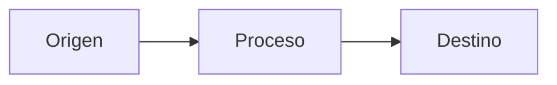

> **Proyecto objetivo (automatico):** si en ESTA conversacion se ejecuto `/proyecto <X>`, todo este comando opera sobre la carpeta de ese proyecto (la que fijo `/proyecto`) y no sobre el directorio del chat: `git -C <carpeta>`, archivos, WORK_SESSION.md y TASKS.md de esa carpeta, `-Repo <X>` en sync-agents, y el vault se sincroniza primero. Si nunca se ejecuto `/proyecto`, usa el directorio actual.

### 0. Datos del proyecto
- Nombre: [NOMBRE]
- Ruta repo orquestador: [RUTA_REPO]
- Ruta del proyecto: [RUTA_CODIGO]
- Nota Obsidian: [NOTA_OBSIDIAN]

### 1. Identidad del agente
Actuás como un agente técnico encargado de normalizar el proyecto al circuito estándar.
No modificar archivos en `[RUTA_REPO]` salvo el vault.

### 2. Handoff — ¿vengo de otra IA?
1. Leer `WORK_SESSION.md`
   - Si `handoff: true` → cambiar a `handoff: false`
2. Leer `git log -1`
3. Leer `git diff --stat`
4. Leer `git status`
5. Leer `TASKS.md` → buscar `@cualquier_ia`
6. Si hay cambios sin commit → preguntarme

### 3. Lectura de contexto global
Leer en modo solo lectura:

- `[RUTA_REPO]AGENTS.md`
- `[RUTA_REPO]obsidian-vault/00 - Meta/Prompt-Reset-Contexto.md`
- `[RUTA_REPO]obsidian-vault/00 - Meta/Templates/_proyecto.md`
- `[RUTA_REPO]obsidian-vault/00 - Meta/Bago IT.md` (departamento Infraestructura) o `Gobierno de Datos.md` (según corresponda)

Referencias:
- [[00 - Meta/CodeGraph]]
- [[00 - Meta/Prompt-Reset-Contexto]]

### 4. Setup del proyecto
1. **Hooks:**
   - Verificar `core.hooksPath`
   - Si no apunta a `.githooks\` → corregir

2. **CodeGraph:**
   - `codegraph status`
   - Si desactualizado → `codegraph sync`
   - Registrar estado como `[CODEGRAPH]`

3. **Archivos base:**
   - Crear `CLAUDE.md` si falta
   - Crear `WORK_SESSION.md` si falta
   - Crear `TASKS.md` si falta

### 5. Crear/actualizar CLAUDE.md

```markdown
# [NOMBRE] — Contexto para IAs

## Propósito
[Qué problema resuelve, para quién]

## Stack
- [Tecnologías principales]

## Archivos clave
- [Entry points y módulos principales]

## Reglas específicas
- [Restricciones operativas, credenciales, dependencias críticas]

## Qué NO tocar
- [Gotchas conocidos desde el inicio]

## Restricciones de Entorno
- Código: `[RUTA_CODIGO]`
- No modificar archivos en `[RUTA_REPO]`
- Documentación de alto nivel en `[NOTA_OBSIDIAN]` (solo propósito + stack)
- ADRs en `[RUTA_REPO]obsidian-vault\02 - Decisiones\YYYY-MM-DD-titulo.md`
- WORK_SESSION: `WORK_SESSION.md`
- TASKS: `TASKS.md`
- Hooks: `.githooks\`

## Handoff
- WORK_SESSION.md con `handoff: true` = otra IA dejó trabajo pendiente
- TASKS.md con `@cualquier_ia` = tarea disponible para cualquier IA
- Siempre dejar `handoff: true` + commit antes de salir

## CodeGraph
[CODEGRAPH]

## Skills aplicables
- `obsidian-markdown` — al tocar el vault
- `frontend-design` — si hay UI/web
- Usar `find-skills` si hay dudas sobre qué skill aplicar
```

### 6. Crear/actualizar WORK_SESSION.md

```yaml
handoff: false
ultima_accion: "alineación del proyecto"
```

### 7. Crear/actualizar TASKS.md

```markdown
# Tareas — [NOMBRE]

- [ ] Revisar backlog inicial @cualquier_ia
```

### 8. Crear/recrear README.md

**Regla:** el `README.md` raíz NO es un placeholder de 2 líneas — es la primera impresión del proyecto en GitHub. Si al alinear un proyecto existente el README es débil (mínimo, con placeholders sin completar, sin estructura visual), **recrearlo en esta misma sesión** con este estándar — no dejarlo para después. Usar esta estructura como piso mínimo, expandiendo lo que el proyecto amerite:

```markdown
# [Emoji] [NOMBRE]

> [Tagline de una línea — qué hace y para quién]

  

## 📋 Qué es esto

[3-5 líneas: problema real que resuelve, para quién, por qué existe]

## ✨ Características

- [Punto concreto real]
- [Otro punto concreto real]

## 🏗️ Stack

| Tecnología | Uso |
|---|---|
| [tech] | [para qué] |

<!-- Si hay flujo/pipeline (datos, deploy, cron), agregar Mermaid -->


## 📁 Estructura

```
[árbol real de carpetas/archivos clave]
```

## 🚀 Cómo usar

[Pasos reales de instalación/ejecución/deploy]

## 📚 Documentación

- `CLAUDE.md` — contexto técnico completo
- Nota del vault: `[[01 - Proyectos/[Departamento]/[NOMBRE]]]`
- ADRs: `../obsidian-vault/02 - Decisiones/`

## 🤖 IAs compatibles

Claude Code · Opencode · Antigravity — contrato compartido en `AGENTS.md`

---

**Owner:** Haward Tillero · **Departamento:** [...] · **Estado:** [...]
```

### 9. Alta en Obsidian (si falta)
Usar `obsidian-markdown` para:

1. Crear `[NOTA_OBSIDIAN]` en `01 - Proyectos/[Departamento]/[NOMBRE].md` con template `_proyecto.md`
2. Completar: propósito, stack, integraciones, link al repo, `codegraph: [CODEGRAPH]`
3. Actualizar el índice del departamento (`Bago IT.md` o `Gobierno de Datos.md`)

### 10. Commit de alineación

```markdown
chore: alineación del proyecto [NOMBRE]

🤖 IA: [Claude Code | Opencode | Antigravity]
Co-Authored-By: [Claude Code <noreply@anthropic.com> | Opencode <noreply@opencode.ai> | Antigravity <noreply@gemini.google.com>]
```

### 11. Checklist final
- [ ] Handoff resuelto
- [ ] Hooks verificados
- [ ] CodeGraph actualizado
- [ ] CLAUDE.md completo
- [ ] WORK_SESSION.md creado/actualizado
- [ ] TASKS.md creado/actualizado
- [ ] README.md creado
- [ ] Nota en Obsidian creada/verificada
- [ ] Commit realizado
- [ ] No se modificó nada fuera del vault

---
