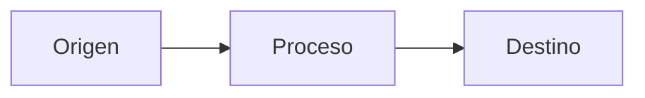

### 0. Datos del proyecto
- Nombre del proyecto: [NOMBRE]
- Ruta del repo orquestador: [RUTA_REPO]
- Ruta del proyecto: [RUTA_CODIGO]
- Ruta de la nota en Obsidian: [NOTA_OBSIDIAN]
- Estado CodeGraph: [CODEGRAPH]

### 1. Identidad del agente
Actuás como un agente técnico con acceso a la skill `obsidian-markdown`.
No modificar archivos en `[RUTA_REPO]`.

### 2. Lectura de contexto global (solo lectura)
Leé:

- `[RUTA_REPO]AGENTS.md`
- `[RUTA_REPO]obsidian-vault/00 - Meta/Templates/_proyecto.md`
- `[RUTA_REPO]obsidian-vault/00 - Meta/Prompt-Reset-Contexto.md`
- `[RUTA_REPO]obsidian-vault/00 - Meta/Bago IT.md` (departamento Infraestructura) o `Gobierno de Datos.md` (según corresponda)

Referencias:
- [[00 - Meta/CodeGraph]]
- [[00 - Meta/Prompt-Reset-Contexto]]

### 3. Crear la nota del proyecto
Usando exclusivamente `obsidian-markdown`:

1. Identificar el departamento del proyecto (Infraestructura, Gobierno de Datos, u otro nuevo).
2. Crear `[NOTA_OBSIDIAN]` en `01 - Proyectos/[Departamento]/[NOMBRE].md` usando el template `_proyecto.md`.
3. Completar:
   - propósito
   - stack
   - integraciones
   - link al repo
   - `codegraph: [CODEGRAPH]`
4. No incluir código del proyecto.

### 4. Registrar el proyecto en el vault
Actualizar el índice del departamento correspondiente:
- Infraestructura → `Bago IT.md` (tabla "con agente Opencode" o "solo en GitHub" según corresponda)
- Gobierno de Datos → `Gobierno de Datos.md`
- Otro departamento nuevo → crear su propio índice en `00 - Meta/` (ver [[00 - Meta/Guía de Uso]])

### 5. Skills check
Usar solo:
- `obsidian-markdown`

### 6. Crear README.md

**Regla:** el `README.md` raíz de un repo NO es un placeholder de 2 líneas — es la primera impresión del proyecto en GitHub. Tiene que ser una vista completa, profesional y visualmente prolija: badges, secciones reales con contenido real (no `[texto entre corchetes]` sin completar), y un diagrama (Mermaid, GitHub lo renderiza nativo) cuando el proyecto tiene un flujo/pipeline que se explica mejor visualmente que en prosa. Usar SIEMPRE esta estructura como piso mínimo, expandiendo lo que el proyecto amerite:

```markdown
# [Emoji] [NOMBRE]

> [Tagline de una línea — qué hace y para quién, no un genérico "proyecto de X"]

  

## 📋 Qué es esto

[3-5 líneas: qué problema real resuelve, para quién, por qué existe — contexto de negocio, no solo técnico]

## ✨ Características

- [Punto concreto de lo que hace/resuelve — no genérico]
- [Otro punto concreto]
- [...]

## 🏗️ Stack

| Tecnología | Uso |
|---|---|
| [tech 1] | [para qué] |
| [tech 2] | [para qué] |

<!-- Si el proyecto tiene un flujo/pipeline (datos, deploy, cron) agregar un diagrama Mermaid acá -->


## 📁 Estructura

```
[árbol real de carpetas/archivos clave, no genérico]
```

## 🚀 Cómo usar

[Pasos reales de instalación/ejecución/deploy — comandos reales, no genéricos]

## 📚 Documentación

- `CLAUDE.md` — contexto técnico completo para IAs
- Nota del vault: `[[01 - Proyectos/[Departamento]/[NOMBRE]]]`
- ADRs: `../obsidian-vault/02 - Decisiones/`

## 🤖 IAs compatibles

Claude Code · Opencode · Antigravity — contrato compartido en `AGENTS.md`

---

**Owner:** Haward Tillero · **Departamento:** [Infraestructura/Gobierno de Datos/Personal] · **Estado:** [activo/mantenimiento/archivado]
```

Esta misma regla aplica a **todos los proyectos existentes**, no solo a los nuevos — si se detecta un README.md débil al alinear un proyecto (`/alinear`), recrearlo con este estándar en la misma sesión, no dejarlo para después.

### 7. Checklist final
- [ ] Nota creada correctamente
- [ ] Template aplicado
- [ ] Campo `codegraph:` correcto
- [ ] Registro actualizado en el índice del departamento (`Bago IT.md` o `Gobierno de Datos.md`)
- [ ] README.md creado
- [ ] No se modificó nada en `[RUTA_REPO]` fuera del vault

---
